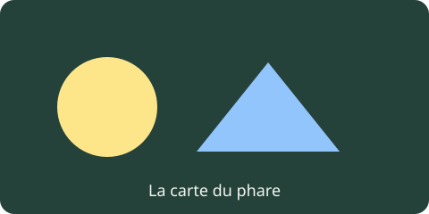

# Le manuel du phare {align:center}

[[toc]]

## Colonnes

::::canvas{responsive}
:::texte{two-thirds}
Le phare guide les navires depuis 1902. Un [mot surligné]{bg:#fde68a, color:#1b3a33}, un <u>mot souligné</u> et une note[^histoire].
:::
:::image{third}
{#fig-carte, radius:md}
:::
::::

Voir @fig-carte pour l’emplacement.

## Page libre

::::page{size:16:9, bg:#0f172a}
:::titre{x:8%, y:12%, w:84%, h:30%, size:48px, weight:700, color:#fde68a}
Une page composée comme une diapositive
:::
:::forme{x:8%, y:55%, w:30%, h:30%, shape:ellipse, fill:#93c5fd}
:::
::::

## Tableau fusionné

| Poste | Matin | Après-midi |
|---|---|---|
| Lundi {bg:#24423a} | Ouvert | > |
| Mardi | Fermé | Ouvert |
| Mercredi | ^ | Fermé |

## Encadrés et tâches

> [!NOTE]
> Le phare se visite sur rendez-vous.

> [!WARNING]
> L’escalier compte 230 marches.

- [x] Vérifier la lampe
- [ ] Repeindre la porte

## Équation

$$
d = \sqrt{2 R h} \label{portee}
$$

La portée est donnée par $\eqref{portee}$.

## Vidéo

!video(https://www.youtube.com/watch?v=dQw4w9WgXcQ){width:full}

---slide---

Fin du manuel.

[^histoire]: Construit après le naufrage de 1899.
